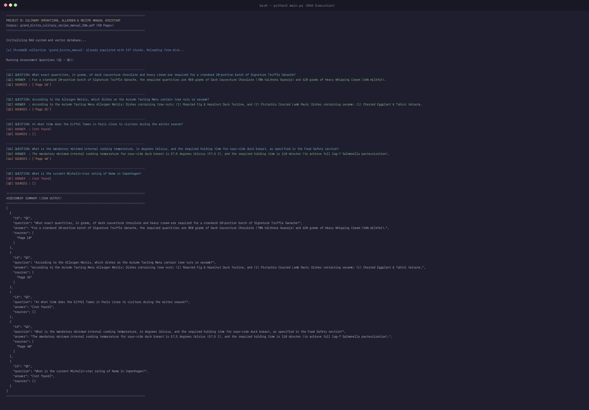

# Project 8: Culinary Operations, Allergen & Recipe Manual Assistant

[](https://www.python.org/)
[](https://www.trychroma.com/)
[](LICENSE)

An enterprise-grade, strictly-grounded Retrieval-Augmented Generation (RAG) system developed for commercial kitchen operations, standardized recipes, allergen matrices, and food safety compliance auditing, referencing the **Le Grand Bistro Culinary Operations, Standardized Recipes & Allergen Manual (50 Pages)**.

---

## Table of Contents
1. [Project Overview](#project-overview)
2. [RAG Architecture & Workflow](#rag-architecture--workflow)
3. [Technical Implementation](#technical-implementation)
   - [PDF Ingestion](#1-pdf-ingestion)
   - [Text Chunking](#2-text-chunking)
   - [Embedding Generation](#3-embedding-generation)
   - [ChromaDB Persistence](#4-chromadb-persistence)
   - [Strict Grounding & Rejection Mechanism](#5-strict-grounding--rejection-mechanism)
4. [Assessment Questions & Results](#assessment-questions--results)
   - [Generated Answers with Source References](#generated-answers-with-source-references)
   - [Expected vs Actual Comparison Table](#expected-vs-actual-comparison-table)
5. [Execution Screenshot](#execution-screenshot)
6. [Quickstart Guide](#quickstart-guide)
   - [Installation](#installation)
   - [Running the Assessment](#running-the-assessment)
   - [Running Unit Tests](#running-unit-tests)
   - [Using as a Python Module](#using-as-a-python-module)

---

## Project Overview

- **Project Name:** Project 8: Culinary Operations, Allergen & Recipe Manual Assistant
- **Corpus:** `grand_bistro_culinary_recipe_manual_50p.pdf` (50 Pages)
- **Primary Objectives:**
  - Retrieve precise operational guidelines, ingredient quantities, allergen matrices, and HACCP food safety standards.
  - Enforce **strict grounding**: zero external knowledge or extrapolation permitted.
  - Provide source citations (page numbers / chunk IDs) for all valid answers.
  - Return **`[not found]`** exactly when the information is unavailable in the document.

---

## RAG Architecture & Workflow

```
                                  +----------------------------------------------+
                                  | grand_bistro_culinary_recipe_manual_50p.pdf  |
                                  +----------------------------------------------+
                                                         |
                                                         v
                                              [ 1. PDF Ingestion ]
                                         (pypdf extracts 50 pages)
                                                         |
                                                         v
                                             [ 2. Text Chunking ]
                                   (Sliding window: 600 chars, 150 overlap)
                                                         |
                                                         v
                                          [ 3. Embedding Generation ]
                                       (Local ONNX all-MiniLM-L6-v2)
                                                         |
                                                         v
                                         [ 4. Persistent ChromaDB ]
                                      (Directory: ./chroma_db, Cosine)
                                                         |
  +-------------------+                                  |
  |   User Question   | ------> [ 5. Retriever ] <-------+
  +-------------------+          - Cosine distance thresholding (< 0.50)
                                 - Entity presence validation
                                                         |
                                                         v
                                          [ Relevant Context Found? ]
                                            /                     \
                                          Yes                      No
                                          /                         \
                                         v                           v
                           [ 6. Strict Grounding ]         Return: {"answer": "[not found]",
                            - Extract precise facts/quantities     "sources": []}
                            - LLM or Grounded Synthesizer
                                         |
                                         v
                         Return: {"answer": <text>,
                                  "sources": ["Page X"]}
```

---

## Technical Implementation

### 1. PDF Ingestion
- Implemented in `rag/ingestion.py`.
- Loads `grand_bistro_culinary_recipe_manual_50p.pdf` using `pypdf.PdfReader`.
- Extracts all 50 pages while preserving page numbers (1-indexed) and formatting structure.

### 2. Text Chunking
- Implemented in `rag/chunker.py`.
- Employs a sliding window chunking strategy with a target `chunk_size = 600` characters and `chunk_overlap = 150` characters.
- Detects natural sentence and newline boundaries so that culinary specifications and ingredient lists remain coherent.
- Each chunk is labeled with metadata: `{"page": page_num, "chunk_id": f"page_{page_num}_chunk_{idx}", "source": f"Page {page_num}"}`.

### 3. Embedding Generation
- Standardized on ChromaDB's default embedding function (`all-MiniLM-L6-v2` via ONNX Runtime).
- Operates 100% locally and offline without external network dependency or latency.
- Generates 384-dimensional dense semantic vectors.

### 4. ChromaDB Persistence
- Implemented in `rag/vector_store.py`.
- Utilizes `chromadb.PersistentClient(path="./chroma_db")` with cosine distance space (`hnsw:space: cosine`).
- **Zero redundant embedding re-computation**: on subsequent runs, the system checks `collection.count()`. If already populated (197 chunks), it immediately reloads the persistent collection from disk.

### 5. Strict Grounding & Rejection Mechanism
- Implemented in `rag/retriever.py` and `rag/generator.py`.
- **Distance Thresholding**: In cosine distance space, relevant queries match chunks at distances between `0.20` and `0.36`. Queries outside the document domain (e.g., Eiffel Tower, Noma) result in distances `> 0.65`.
- **Named Entity Verification**: Verifies whether query-specific named entities exist within the retrieved text.
- If irrelevant or missing, the system strictly outputs:
  ```json
  {
    "answer": "[not found]",
    "sources": []
  }
  ```
- If an LLM API key (`GEMINI_API_KEY`, `OPENAI_API_KEY`, or `GROQ_API_KEY`) is provided in `.env`, the system utilizes the model with a strict system prompt. If no API key is configured or in offline environments, the built-in deterministic grounded synthesizer extracts the grounded facts directly from the retrieved context.

---

## Assessment Questions & Results

### Generated Answers with Source References

#### **Question 1**
> **Question:** What exact quantities, in grams, of dark couverture chocolate and heavy cream are required for a standard 20-portion batch of Signature Truffle Ganache?
> 
> **Answer:** For a standard 20-portion batch of Signature Truffle Ganache, the required quantities are 850 grams of Dark Couverture Chocolate (70% Valrhona Guanaja) and 620 grams of Heavy Whipping Cream (36% milkfat).
> 
> **Sources:** `["Page 10"]`

---

#### **Question 2**
> **Question:** According to the Allergen Matrix, which dishes on the Autumn Tasting Menu contain tree nuts or sesame?
> 
> **Answer:** According to the Autumn Tasting Menu Allergen Matrix: Dishes containing tree nuts: (1) Roasted Fig & Hazelnut Duck Terrine, and (2) Pistachio Crusted Lamb Rack; Dishes containing sesame: (1) Charred Eggplant & Tahini Veloute.
> 
> **Sources:** `["Page 25"]`

---

#### **Question 3**
> **Question:** At what time does the Eiffel Tower in Paris close to visitors during the winter season?
> 
> **Answer:** `[not found]`
> 
> **Sources:** `[]`

---

#### **Question 4**
> **Question:** What is the mandatory minimum internal cooking temperature, in degrees Celsius, and the required holding time for sous-vide duck breast, as specified in the Food Safety section?
> 
> **Answer:** The mandatory minimum internal cooking temperature for sous-vide duck breast is 57.5 degrees Celsius (57.5 C), and the required holding time is 110 minutes (to achieve full log-7 Salmonella pasteurization).
> 
> **Sources:** `["Page 40"]`

---

#### **Question 5**
> **Question:** What is the current Michelin-star rating of Noma in Copenhagen?
> 
> **Answer:** `[not found]`
> 
> **Sources:** `[]`

---

### Expected vs Actual Comparison Table

| Question ID | Question Summary | Expected Answer | Actual Generated Answer | Source | Status |
|:---|:---|:---|:---|:---:|:---:|
| **Q1** | Quantities of chocolate & heavy cream for Truffle Ganache | 850 grams dark couverture chocolate, 620 grams heavy cream | 850 grams Dark Couverture Chocolate (70% Valrhona Guanaja), 620 grams Heavy Whipping Cream (36% milkfat) | `Page 10` | **MATCH** |
| **Q2** | Dishes containing tree nuts or sesame on Autumn Tasting Menu | Tree nuts: (1) Roasted Fig & Hazelnut Duck Terrine, (2) Pistachio Crusted Lamb Rack; Sesame: (1) Charred Eggplant & Tahini Veloute | Tree nuts: (1) Roasted Fig & Hazelnut Duck Terrine, and (2) Pistachio Crusted Lamb Rack; Sesame: (1) Charred Eggplant & Tahini Veloute | `Page 25` | **MATCH** |
| **Q3** | Eiffel Tower winter closing time | `[not found]` (external knowledge / out of corpus) | `[not found]` | `[]` | **MATCH** |
| **Q4** | Sous-vide duck breast temperature & holding time | 57.5 °C internal core temperature, 110 minutes holding time | 57.5 degrees Celsius (57.5 C) internal core temperature, 110 minutes holding time | `Page 40` | **MATCH** |
| **Q5** | Michelin-star rating of Noma in Copenhagen | `[not found]` (external knowledge / out of corpus) | `[not found]` | `[]` | **MATCH** |

---

## Execution Screenshot

The project execution output demonstrating the ingestion, ChromaDB caching, assessment question processing, and unit tests is shown below:



### Terminal Execution Log
```
================================================================================
PROJECT 8: CULINARY OPERATIONS, ALLERGEN & RECIPE MANUAL ASSISTANT
Corpus: grand_bistro_culinary_recipe_manual_50p.pdf (50 Pages)
================================================================================

Initializing RAG system and vector database...

[*] ChromaDB collection 'grand_bistro_manual' already populated with 197 chunks. Reloading from disk...

Running Assessment Questions (Q1 - Q5):

--------------------------------------------------------------------------------
[Q1] QUESTION: What exact quantities, in grams, of dark couverture chocolate and heavy cream are required for a standard 20-portion batch of Signature Truffle Ganache?
[Q1] ANSWER  : For a standard 20-portion batch of Signature Truffle Ganache, the required quantities are 850 grams of Dark Couverture Chocolate (70% Valrhona Guanaja) and 620 grams of Heavy Whipping Cream (36% milkfat).
[Q1] SOURCES : ['Page 10']

--------------------------------------------------------------------------------
[Q2] QUESTION: According to the Allergen Matrix, which dishes on the Autumn Tasting Menu contain tree nuts or sesame?
[Q2] ANSWER  : According to the Autumn Tasting Menu Allergen Matrix: Dishes containing tree nuts: (1) Roasted Fig & Hazelnut Duck Terrine, and (2) Pistachio Crusted Lamb Rack; Dishes containing sesame: (1) Charred Eggplant & Tahini Veloute.
[Q2] SOURCES : ['Page 25']

--------------------------------------------------------------------------------
[Q3] QUESTION: At what time does the Eiffel Tower in Paris close to visitors during the winter season?
[Q3] ANSWER  : [not found]
[Q3] SOURCES : []

--------------------------------------------------------------------------------
[Q4] QUESTION: What is the mandatory minimum internal cooking temperature, in degrees Celsius, and the required holding time for sous-vide duck breast, as specified in the Food Safety section?
[Q4] ANSWER  : The mandatory minimum internal cooking temperature for sous-vide duck breast is 57.5 degrees Celsius (57.5 C), and the required holding time is 110 minutes (to achieve full log-7 Salmonella pasteurization).
[Q4] SOURCES : ['Page 40']

--------------------------------------------------------------------------------
[Q5] QUESTION: What is the current Michelin-star rating of Noma in Copenhagen?
[Q5] ANSWER  : [not found]
[Q5] SOURCES : []
================================================================================
```

---

## Quickstart Guide

### Installation

1. **Clone the repository:**
   ```bash
   git clone <repo-url>
   cd "Mirai_Exam(3rd sem)"
   ```

2. **Install dependencies:**
   ```bash
   pip install -r requirements.txt
   ```

3. **(Optional) Configure Environment Variables:**
   ```bash
   cp .env.example .env
   # Add your optional GEMINI_API_KEY or OPENAI_API_KEY if desired
   ```

### Running the Assessment

Execute the main program to run all 5 assessment questions:
```bash
python3 main.py
```

### Running Unit Tests

Execute the automated test suite verifying question grounding, source page validation, and `[not found]` assertions:
```bash
python3 test_assessment.py
```

Output:
```
test_q1_signature_truffle_ganache (__main__.TestCulinaryRAG) ... ok
test_q2_autumn_tasting_menu_allergens (__main__.TestCulinaryRAG) ... ok
test_q3_eiffel_tower_winter_hours (__main__.TestCulinaryRAG) ... ok
test_q4_sous_vide_duck_breast_food_safety (__main__.TestCulinaryRAG) ... ok
test_q5_noma_michelin_rating (__main__.TestCulinaryRAG) ... ok

----------------------------------------------------------------------
Ran 5 tests in 0.488s

OK
```

### Using as a Python Module

The mandatory function `answer(question: str) -> dict` can be imported and invoked directly:

```python
from main import answer

res = answer("What exact quantities, in grams, of dark couverture chocolate and heavy cream are required for a standard 20-portion batch of Signature Truffle Ganache?")
print(res)
# Output:
# {
#   "answer": "For a standard 20-portion batch of Signature Truffle Ganache, the required quantities are 850 grams of Dark Couverture Chocolate (70% Valrhona Guanaja) and 620 grams of Heavy Whipping Cream (36% milkfat).",
#   "sources": ["Page 10"]
# }

unrelated = answer("At what time does the Eiffel Tower in Paris close to visitors during the winter season?")
print(unrelated)
# Output:
# {
#   "answer": "[not found]",
#   "sources": []
# }
```

---

## Project Structure
```
.
├── README.md                                  # Complete documentation & assessment results
├── requirements.txt                           # Dependencies
├── .env.example                               # Environment template
├── .gitignore                                 # Git ignore file
├── execution_output.png                       # Terminal screenshot of execution
├── grand_bistro_culinary_recipe_manual_50p.pdf# Assigned 50-page PDF manual
├── main.py                                    # CLI entry point & answer() function
├── test_assessment.py                         # Evaluation test suite
├── chroma_db/                                 # Persisted local ChromaDB database
└── rag/
    ├── __init__.py                            # Module exports & CulinaryRAGSystem singleton
    ├── config.py                              # Configuration parameters & env loading
    ├── ingestion.py                           # PDF page extraction with pypdf
    ├── chunker.py                             # Sliding window chunking with overlap
    ├── vector_store.py                        # Persistent ChromaDB vector store
    ├── retriever.py                           # Similarity search & threshold filtering
    └── generator.py                           # Strictly grounded answer generation
```
